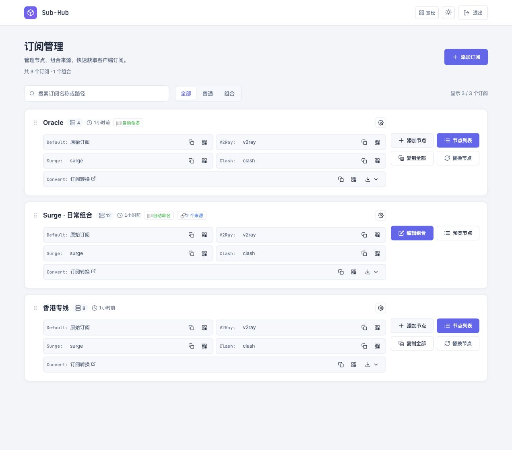
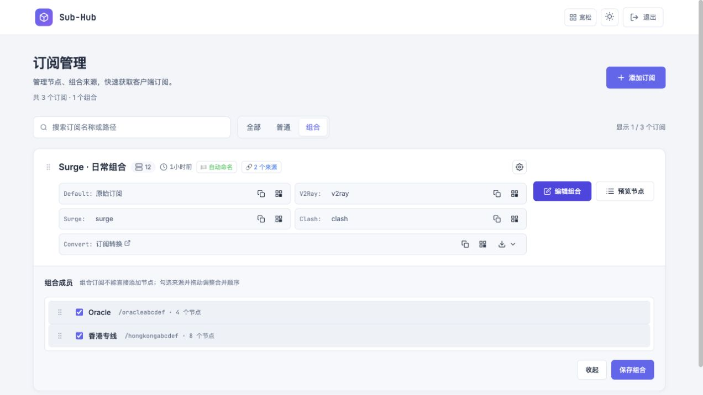
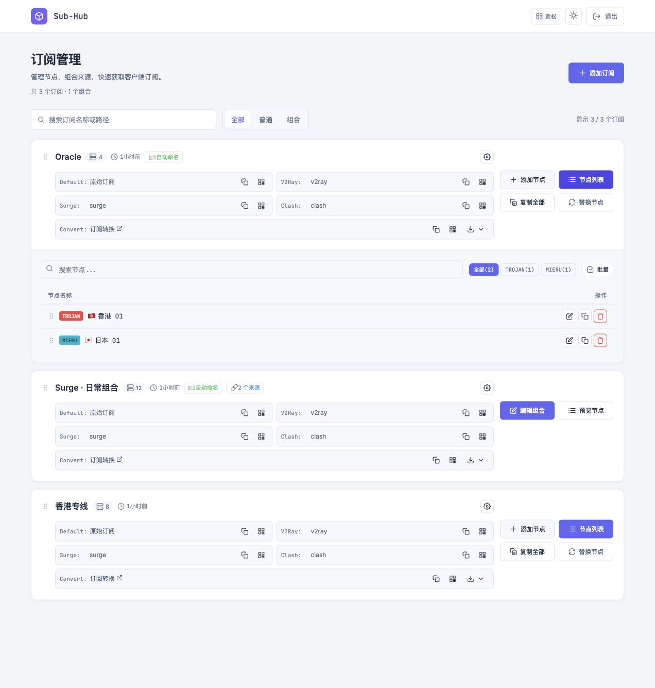
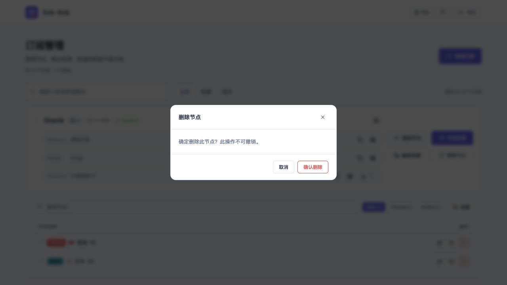
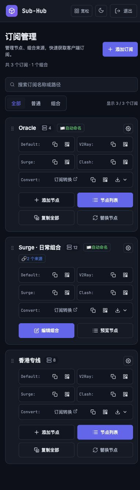

# Sub-Hub Enhanced

基于 Cloudflare Workers + D1 的代理节点订阅管理器，提供网页管理、组合订阅、自动命名与多客户端输出。

[](https://deploy.workers.cloudflare.com/?url=https://github.com/meloay/sub-hub)

## 界面预览

以下截图使用本机演示数据，所有节点、订阅名称和路径均为虚构，不包含真实账号或节点凭据。

### 订阅管理

搜索、普通／组合筛选、多客户端订阅链接，以及对齐的常用操作按钮。



### 组合订阅编辑

在卡片内展开成员列表，一行显示一个来源，可勾选成员并拖动调整合并顺序。



<details>
<summary>查看更多：节点列表、删除确认框、手机端深色模式</summary>

### 节点列表

展示协议类型、国家／地区命名与旗帜，并提供编辑、复制、删除和批量操作。



### 页面内确认框

危险操作使用统一的页面内确认框，不再弹出浏览器原生确认窗口。



### 手机端深色模式

双栏订阅入口与适合触屏的操作布局，支持深浅主题切换。



</details>

## 一键部署到自己的账号

点击上方按钮，登录自己的 Cloudflare 与 GitHub 账号，在引导页面设置项目名称、管理员用户名与强密码。Cloudflare 会复制仓库、创建并绑定独立 D1 数据库，并通过部署命令自动初始化表结构和发布 Worker；无需使用本项目维护者的账号或令牌。

**Turnstile 需要使用你自己的站点密钥，不能自动替你创建。** 如果已经知道最终使用的自定义域名，可先在 Turnstile 创建站点并填入部署页面的 `TURNSTILE_SITE_KEY` 和 `TURNSTILE_SECRET_KEY`。如果暂时不知道自动分配的 workers.dev 域名，请在部署完成后：

1. 在 Worker 的 Domains & Routes 找到实际访问域名。
2. 在 Cloudflare → Turnstile 创建站点，选择 Managed，将该域名加入允许列表。
3. 在 Worker 的 Variables and Secrets 中设置 `TURNSTILE_SITE_KEY`（变量）和 `TURNSTILE_SECRET_KEY`（密钥），保存并部署配置。
4. 访问 `https://你的域名/admin` 登录。管理路径以 `ADMIN_PATH` 配置为准。

未配置管理员凭据或 Turnstile 时，服务会拒绝提供正常访问（503），不会退回默认密码或跳过验证。域名校验自动严格匹配当前访问主机名，无需改源码；可用 `TURNSTILE_HOSTNAME` 额外固定一个主机名。

一键部署以 [Cloudflare 官方部署按钮](https://developers.cloudflare.com/workers/platform/deploy-buttons/)为基础。首次接入需由使用者确认账号授权与配置，因此不是完全无需输入的部署。不要把数据库选为已有生产库：`deploy-migrations/` 是新部署的完整初始化迁移；旧版本升级需另行核对表结构。

部署命令应保持 `npm run deploy`，它会先应用 D1 迁移再发布，迁移失败则停止发布。之后通过自己的复制仓库更新代码时，可以沿用 Cloudflare Workers Builds 自动部署。

## 原作与致谢

本项目是在 **shiyi11yi** 的 **Sub-Hub** 基础上修改而来，并非从零原创。感谢原作者的工作，以及保留历史代码的贡献者。

- 原作者历史仓库：[shiyi11yi/Sub-Hub](https://github.com/shiyi11yi/Sub-Hub)（目前不可访问）。
- 可查阅的历史备份：[kazami287/Sub-Hub](https://github.com/kazami287/Sub-Hub)，保留原作者提交记录。
- 自动命名思路参考：[Keywos/rule](https://github.com/Keywos/rule)。未打包其原始脚本，不将其参考思路的署名视为转载授权。
- 完整来源说明：[CREDITS.md](CREDITS.md)。

未找到基础项目的明确许可证，本仓库不擅自将继承代码重新标记为 MIT、Apache 等许可。代码公开可查阅，不代表所有内容都已获得任意再分发授权；相关权利归原作者及各贡献者所有。

## 主要改进

- Mieru、WireGuard 节点识别及相关输出处理；保留 SS、VMess、Trojan、VLESS、SOCKS、Hysteria2、TUIC、Surge Snell 等原有处理。
- 普通订阅与组合订阅：成员选择、顺序调整、去重、循环和嵌套检查。
- 自动国家／地区命名、旗帜、分组排序；可按订阅开启，台湾地区使用中国旗帜。
- 新订阅路径自动生成：名称规范化前缀 + 6 位字母数字，不修改已有路径。
- Turnstile 登录验证、会话管理、请求边界检查。
- 搜索与类型筛选、深浅主题、响应式布局、自定义确认对话框。
- 回归测试与只读演示页面。

协议识别不代表每个输出格式和每个客户端都支持该协议。尤其 Mieru、WireGuard、Snell 的支持取决于客户端和格式，请使用自己的客户端验证。

## 全新部署

1. 在 Cloudflare 创建一个 Worker 和 D1 数据库，将 D1 绑定名设置为 `DB`。
2. 在 D1 控制台执行 [schema.sql](schema.sql)。这是完整的新库结构，**执行后不需要再执行 migrations**。
3. 创建 Turnstile 站点，将实际使用的域名加入允许列表，保存 Site Key 与 Secret Key。
4. 将实际域名加入 Turnstile 允许列表。域名验证默认严格匹配访问请求的主机名；如需固定域名，可设置 `TURNSTILE_HOSTNAME`，只填主机名、不带协议或路径。
5. 设置 Worker 绑定：

| 名称 | 类型 | 用途 |
| --- | --- | --- |
| `DB` | D1 | 数据库 |
| `ADMIN_PATH` | 变量 | 管理路径，例如 `admin` |
| `ADMIN_USERNAME` | 密钥 | 管理用户名 |
| `ADMIN_PASSWORD` | 密钥 | 强密码，无默认凭据 |
| `TURNSTILE_SITE_KEY` | 变量 | 公开站点密钥 |
| `TURNSTILE_SECRET_KEY` | 密钥 | 服务端验证密钥 |
| `TURNSTILE_HOSTNAME` | 可选变量 | 固定验证主机名；留空自动匹配 |

6. 将 `sub-hub-worker.js` 上传到 Worker 并部署。通过 HTTPS 访问 `https://你的域名/admin`（管理路径以实际配置为准）。

也可以使用 Wrangler：安装依赖，在 `wrangler.jsonc` 中填入自己创建的数据库 ID、站点密钥及管理路径，然后：

```sh
npm ci
npx wrangler login
npx wrangler secret put ADMIN_USERNAME
npx wrangler secret put ADMIN_PASSWORD
npx wrangler secret put TURNSTILE_SECRET_KEY
npm run deploy
```

若已经手动执行 `schema.sql`，则直接运行 `npx wrangler deploy`。已有数据库更新前先备份，再核对实际表结构。`migrations/` 仅包含历史新增字段和组合关系的增量迁移，不是任意历史版本的完整升级方案；不能无条件重复执行。Wrangler 自动部署使用的是独立的 `deploy-migrations/`，不会执行这些历史 ALTER TABLE 文件。

## 订阅输出

- `/<订阅路径>`：原始节点列表。
- `/<订阅路径>/v2ray`：Base64 节点列表。
- `/<订阅路径>/surge`：Surge 输出。
- `/<订阅路径>/clash`：Clash 输出。

订阅路径相当于访问凭据，获得链接的人可能读取节点连接信息，不要公开真实订阅地址。管理后台不应使用弱密码。

管理页面另提供第三方转换后端链接。点击转换可能将订阅地址及节点信息交给所选后端，请仅使用可信服务；本地原生输出与第三方转换是不同的路径。

## 开发与验证

需要 Node.js 22 或更高版本；完整测试还需 Python 3（SQLite）及 Ruby（Psych YAML）。测试不连接线上数据库。

```sh
npm test
npm run preview
```

预览地址为 `http://127.0.0.1:8789/sub`，仅使用虚构数据，拒绝所有修改请求，不用于生产部署。正式登录需要 HTTPS 和正确的 Turnstile 配置。

## 安全发布说明

仓库不包含 Cloudflare/GitHub 令牌、账号专用发布脚本、数据库导出、线上 Turnstile 配置、真实管理员凭据或本机登录文件。`wrangler.jsonc` 是不含账号 ID 或真实资源 ID 的公开模板，`.dev.vars.example` 只声明空白密钥。不要将真实密钥写进配置或提交 `.dev.vars`、`.env` 及数据库备份。
